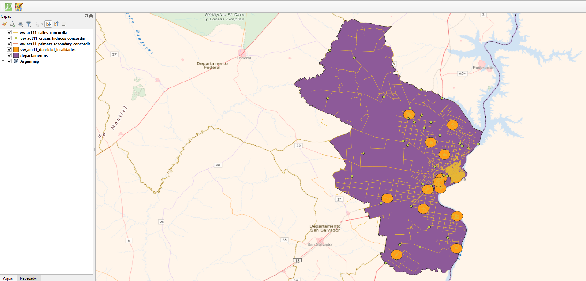
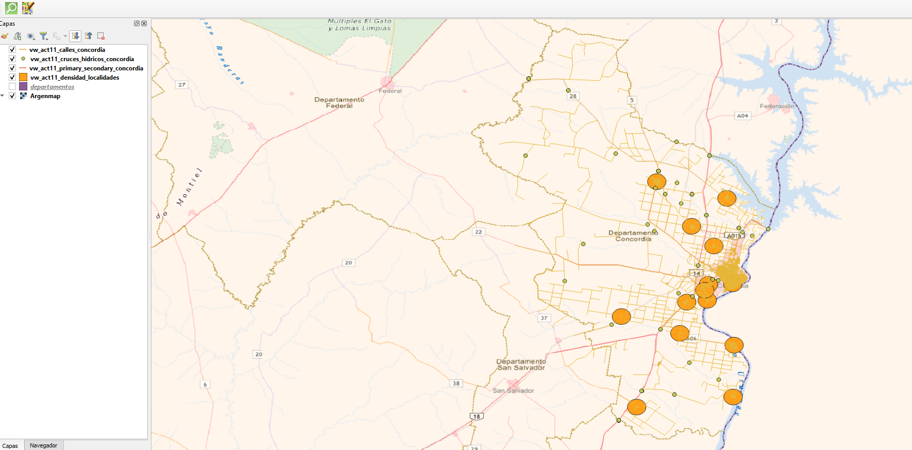

# Informe Técnico - Actividad 11: Calles, OpenStreetMap y Argenmap
**Materia:** Bases de Datos Avanzadas — Licenciatura en Sistemas de Información  
**Facultad:** Ciencia y Tecnología — UADER  
**Trabajo Práctico N° 2:** Bases de Datos Geográficas  
**Departamento de Referencia:** Concordia  
**Autor:** Grigolato  
**Sistema de Referencia Métrico:** EPSG:5343 (POSGAR 07 / Argentina Faja 5)  

---

## 1. Introducción y Objetivos
La trama vial intraurbana y los caminos rurales son indispensables para comprender la conectividad territorial, la logística en situaciones de crisis y el grado de consolidación urbana. En esta actividad se analiza la información de la red vial proveniente de **OpenStreetMap (OSM)**, se cuantifica la densidad vial departamental y local, y se realiza un análisis crítico comparativo frente al mapa base oficial del Instituto Geográfico Nacional (**Argenmap / IGN**).

---

## 2. Metodología y Decisiones Técnicas

### 2.1. Sistema Métrico (EPSG:5343)
Para el cálculo de longitudes (`ST_Length`) y superficies de influencia (`ST_Area`, `ST_Buffer`), se proyectaron las geometrías desde WGS84 (EPSG:4326) hacia **POSGAR 07 Argentina Faja 5 (EPSG:5343)**. Esto evita la distorsión métrica inherente a los cálculos en grados geográficos.

### 2.2. Determinación de la Densidad Vial por Localidad (Buffer de 2 km)
El indicador de densidad vial se define conceptualmente como:

$$\text{Densidad Vial} = \frac{\text{Longitud Total de Calles (km)}}{\text{Superficie de la Localidad (km}^2\text{)}}$$

**Desafío metodológico en OpenStreetMap:**  
Las localidades (`capas.ciudades` / `place = city|town|village`) están registradas como geometrías puntuales (centroides urbanos), sin límites catastrales ni polígonos de ejido urbano asociados. Delimitar a mano o de forma heterogénea los bordes de cada pueblo introduciría un sesgo subjetivo considerable.

**Solución adoptada:**  
Se aplicó un **buffer circular normalizado de radio $R = 2.000\text{ m}$ (2 km)** centrado en cada localidad, estableciendo un área de referencia constante:

$$\text{Área Analizada} = \pi \times R^2 = \pi \times (2\text{ km})^2 \approx 12,57\text{ km}^2$$

Dentro de este disco espacial homogéneo se calcularon las longitudes de los tramos viales intersecados (`ST_Intersection`). Esto permite una comparación equitativa, reproducible y no sesgada de la compacidad de la malla vial entre núcleos urbanos y asentamientos rurales.

---

## 3. Desarrollo y Resultados por Subpunto

### 11.1. Densidad de la Red Vial Departamental
Se cuantificó la longitud acumulada de calles para los 17 departamentos de la provincia de Entre Ríos, determinando el promedio provincial y la posición relativa de Concordia.

* **Hallazgos:**
  - Los departamentos con mayor desarrollo urbano (Paraná, Gualeguaychú y Concordia) lideran ampliamente el volumen de calles mapeadas.
  - Concordia supera de forma notable el promedio provincial en kilómetros de calles, reflejando su rol como segundo polo poblacional y comercial de la provincia.
  - La densidad lineal ($\text{km de calle} / \text{km}^2\text{ departamental}$) pone en evidencia la concentración de infraestructura respecto a la superficie territorial total.

*Script asociado:* `01_densidad_vial_departamental.sql`

---

### 11.2. Densidad Vial por Localidad (Departamento Concordia)
Aplicando la metodología del buffer de 2 km a las localidades de Concordia:
1. **Ciudad de Concordia:** Presenta, con amplia diferencia, la mayor densidad vial urbana ($\text{km/km}^2$), caracterizada por una trama en cuadrícula (*damero*) densa, múltiples avenidas, diagonales y subdivisiones barriales consolidadas.
2. **Localidades satélites (La Criolla, Colonia Ayuí, Puerto Yeruá, Estación Yuquerí, etc.):** Exhiben valores de densidad moderados a bajos, predominando calles troncales de acceso y caminos rurales dispersos rodeados de quintas cítricas y forestaciones.

*Vista para QGIS:* `entrerios.vw_act11_densidad_localidades`  
*Script asociado:* `02_densidad_vial_localidad.sql`

---

### 11.3. Categorías de Calles (`primary` y `secondary`)
Se identificaron los tramos de jerarquía vial principal y secundaria:
* **Primary (Vías primarias):** Corresponden a los corredores nacionales de alta capacidad (RN 14, RN A015) y avenidas de penetración urbana troncales.
* **Secondary (Vías secundarias):** Integran rutas provinciales pavimentadas (RP 22, RP 4) y avenidas interurbanas que conectan los sectores industriales y suburbanos con el centro cívico.

*Vista para QGIS:* `entrerios.vw_act11_primary_secondary_concordia`  
*Script asociado:* `03_categorias_calles.sql`

---

### 11.4. Comparación Exhaustiva entre OpenStreetMap y Argenmap (IGN)

Al visualizar de forma simultánea en QGIS la capa vectorial de calles de OSM y la capa ráster WMTS/TMS de **Argenmap (IGN)**, se observan diferencias conceptuales, metodológicas y cartográficas de gran relevancia:

| Eje de Comparación | OpenStreetMap (OSM) | Argenmap (IGN) |
|---|---|---|
| **Naturaleza de la Fuente** | Base de datos colaborativa abierta (*crowdsourced*), generada por usuarios y mapeadores locales. | Cartografía oficial producida por el Instituto Geográfico Nacional conforme a normas IGM/IGN y ley de la carta. |
| **Cobertura en Áreas Urbanas** | Extremadamente detallada y actualizada; incluye pasajes, calles peatonales, nombres barriales recientes y sentidos de circulación. | Excelente representación general, con generalización cartográfica adaptada a la escala de visualización. |
| **Sectores Rurales** | Gran profusión de caminos de tierra, callejones de fincas, pistas forestales (`track`) y huellas no siempre transitables. | Filtra y jerarquiza estrictamente la red vial pública formal, diferenciando huellas de caminos consolidados. |
| **Precisión Posicional y Alineación** | Trazada comúnmente sobre imágenes satelitales (Bing, Maxar) con desplazamientos locales (*offset*) según la ortorrectificación. | Georreferenciada con marcos de referencia oficiales geodésicos rigurosos (POSGAR). |
| **Zonas Ribereñas y Ríos** | Registra accesos informales a pesqueros, bajadas de lanchas y caminos de sirga ribereños. | Muestra el cauce oficial y las líneas de costa cartográficas históricas estandarizadas. |
| **Puentes y Cruces Hídricos** | Modelados mediante atributos específicos (`bridge=yes`, `layer=1`), aunque a veces falta indicar el material o estado. | Representación simbólica reglamentaria estricta de puentes, alcantarillas y vados. |

#### Conclusión Epistemológica
No se puede calificar a una fuente como intrínsecamente "mejor" que la otra:
* **OSM** ofrece **riqueza semántica, granularidad y actualización continua**, siendo ideal para análisis exploratorios, ruteo y detalles de micromovilidad urbana.
* **Argenmap** garantiza **oficialidad, rigor geodésico y homogeneidad territorial**, indispensable para cartografía legal, convenios institucionales y toponimia formal.
* En situaciones de emergencia, la estrategia óptima consiste en utilizar **ambas de manera complementaria**.

### Evidencia Cartográfica

#### Mapa 1: Trama Vial Urbana/Rural y Zonas de Análisis de Densidad (Buffer 2 km)

#### Mapa 2: Superposición Simultánea con el Mapa Base Oficial Argenmap (IGN)

*Vista para QGIS:* `entrerios.vw_act11_calles_concordia` y `entrerios.vw_act11_cruces_hidricos_concordia`  
*Script asociado:* `04_comparacion_argenmap.sql`

---

## 4. Instrucciones para la Visualización en QGIS
1. Agregar la conexión TMS de Argenmap en QGIS:
   `https://wms.ign.gob.ar/geoserver/gwc/service/tms/1.0.0/capabaseargenmap@EPSG%3A3857@png/{z}/{x}/{-y}.png`
2. Cargar las vistas espaciales de la actividad:
   - `vw_act11_densidad_localidades`: Clasificación graduada por el campo `densidad_km_km2`.
   - `vw_act11_primary_secondary_concordia`: Líneas destacadas en color naranja/rojo.
   - `vw_act11_cruces_hidricos_concordia`: Puntos destacados para verificar puentes sobre ríos y arroyos.
3. Superponer las capas vectoriales sobre Argenmap y realizar acercamientos (*zoom in*) en la zona rural y en el puente sobre el Río Uruguay / Represa de Salto Grande para capturar las evidencias.
