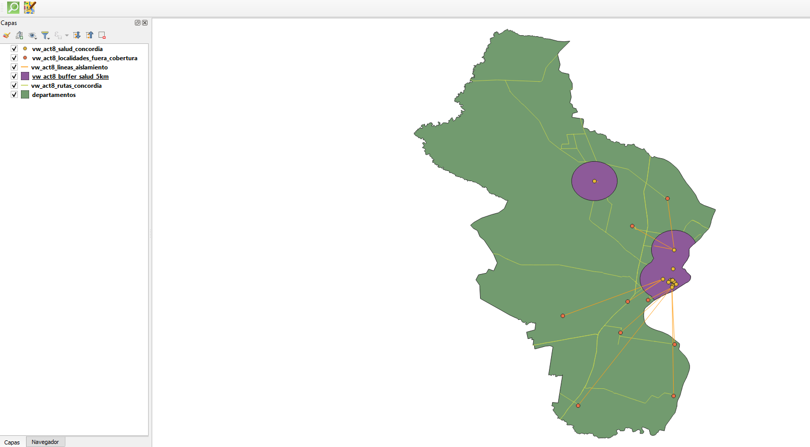

# Informe Técnico - Actividad 8: Rutas y Accesibilidad Sanitaria
**Materia:** Bases de Datos Avanzadas — Licenciatura en Sistemas de Información  
**Facultad:** Ciencia y Tecnología — UADER  
**Trabajo Práctico N° 2:** Bases de Datos Geográficas  
**Departamento de Referencia:** Concordia  
**Autor:** Grigolato  
**Sistema de Referencia Métrico:** EPSG:5343 (POSGAR 07 / Argentina Faja 5)  

---

## 1. Introducción y Objetivos
La accesibilidad a los centros de atención médica resulta crítica para la gestión ante situaciones de emergencia y planificación sanitaria. El departamento Concordia cuenta con un núcleo urbano principal (la ciudad de Concordia) y diversos centros poblados menores dispersos en áreas rurales. 

En esta actividad se evalúa:
1. La estructura de la red vial principal (rutas nacionales y provinciales).
2. El kilometraje efectivo de dichas vías dentro del territorio departamental.
3. La localización y tipología de los establecimientos de salud disponibles.
4. El grado de aislamiento de las poblaciones periféricas mediante el cálculo de distancias mínimas a la atención sanitaria.
5. El área de cobertura efectiva mediante zonas de influencia (*buffers*) de 5 km, identificando las localidades desprotegidas.

---

## 2. Decisiones Técnicas y Metodológicas

### 2.1. Sistema de Coordenadas Proyectado (EPSG:5343)
Las capas cartográficas base provienen en coordenadas geográficas elipsoidales **WGS84 (EPSG:4326)**, cuyas unidades son grados decimales. Los grados no representan distancias constantes sobre la superficie terrestre (a la latitud de Concordia, ~31°S, un grado de longitud equivale a menos distancia en metros que un grado de latitud). 

Para garantizar rigor métrico en los cálculos de longitudes (`ST_Length`), distancias (`ST_Distance`) y áreas de influencia (`ST_Buffer`), todas las geometrías fueron reproyectadas mediante `ST_Transform(geom, 5343)` al sistema oficial **POSGAR 07 / Argentina Faja 5 (EPSG:5343)**, que emplea proyección transversal de Mercator con unidad métrica y mínima distorsión para la provincia de Entre Ríos.

### 2.2. Funciones Espaciales Clave de PostGIS
* `ST_Intersects`: Para identificar relaciones de contacto e inclusión entre rutas, localidades y el polígono departamental.
* `ST_Intersection`: Para recortar estrictamente los tramos de rutas al polígono de Concordia, evitando sumar longitudes que continúan fuera del departamento.
* `ST_Length`: Para cuantificar en metros la longitud de cada línea recortada.
* `ST_Distance`: Para medir la separación mínima ortogonal entre el centroide poblacional y los puntos de salud.
* `ST_Buffer`: Para proyectar el radio de influencia de 5.000 metros (5 km) alrededor de los efectores de salud.
* `ST_Union`: Para fusionar los círculos de cobertura en un polígono único disuelto, eliminando solapamientos internos.

---

## 3. Desarrollo y Resultados por Subpunto

### 8.1. Red Vial Principal que atraviesa Concordia
Concordia está articulada territorialmente por la red vial nacional y provincial:
* **Ruta Nacional 14 (RN 14 / Autovía Gervasio Artigas):** Constituye la columna vertebral del departamento y del corredor del Río Uruguay (Mercosur), conectando de sur a norte.
* **Ruta Nacional A015 (Acceso a Salto Grande):** Conecta la RN 14 con el complejo hidroeléctrico Represa de Salto Grande y el paso fronterizo con Uruguay.
* **Rutas Provinciales (RP 22, RP 4, etc.):** Vinculan la cabecera departamental con departamentos vecinos (Federal, San Salvador) y parajes rurales interiores.

*Script asociado:* `01_red_vial_principal.sql`

---

### 8.2. Longitud de las Rutas dentro del Departamento
Para cada corredor vial, se aplicó la intersección espacial con el límite de Concordia y se calculó la sumatoria métrica de sus tramos en kilómetros:

$$\text{Longitud (km)} = \frac{\sum \text{ST\_Length}(\text{ST\_Transform}(\text{ST\_Intersection}(r.\text{geom}, d.\text{geom}), 5343))}{1000}$$

*Vista para QGIS:* `entrerios.vw_act8_rutas_concordia`  
*Script asociado:* `02_longitud_rutas.sql`

*(Adjuntar tabla de resultados generada por la consulta y captura de la capa en QGIS).*

---

### 8.3. Establecimientos de Salud y Distribución Espacial
En la base de datos de OpenStreetMap se registran hospitales públicos de referencia (como el *Hospital Delicia Concepción Masvernat* y el *Hospital Felipe Heras*), sanatorios privados, clínicas y Centros de Atención Primaria de la Salud (CAPS).

**Análisis de distribución espacial:**
Se observa una **marcada polarización y centralización urbana**:
* Más del 85% de los efectores de salud están concentrados dentro del ejido urbano consolidado de la ciudad de Concordia.
* En el interior rural y en los pueblos satélites, la oferta se reduce a pequeños centros de atención primaria o postas sanitarias con horarios acotados y sin internación o terapia intensiva.

*Vista para QGIS:* `entrerios.vw_act8_salud_concordia`  
*Script asociado:* `03_establecimientos_salud.sql`

---

### 8.4. Localidad más Alejada de un Establecimiento de Salud

#### Metodología y Criterio Utilizado
Para cada localidad registrada en `capas.ciudades`:
1. Se calculó la distancia en metros hacia cada establecimiento de salud del departamento utilizando `ST_Distance` con proyección `EPSG:5343`.
2. Se determinó la menor distancia para cada población (`orden_cercania = 1`).
3. Se ordenó el conjunto de localidades de forma descendente. La primera posición corresponde a la localidad con la mayor distancia mínima al sistema de salud.

> **Justificación del Criterio:** La distancia euclidiana directa (en línea recta proyectada) representa la cota mínima física de proximidad. No depende del estado de transitabilidad de los caminos y evita sesgos de trazado. En una situación de emergencia real, la distancia efectiva por carreteras y caminos vecinales de tierra es sensiblemente mayor, lo que agrava aún más el tiempo de respuesta.

*Vista para QGIS:* `entrerios.vw_act8_lineas_aislamiento` (conecta cada localidad con su hospital más cercano).  
*Script asociado:* `04_localidad_mas_alejada.sql`

---

### 8.5. Área de Cobertura Sanitaria (5 km) y Poblaciones Desprotegidas

#### Generación del Buffer de Influencia
Se aplicó un buffer de $5.000\text{ m}$ ($5\text{ km}$) alrededor de cada punto de salud (`ST_Buffer`), seguido de una disolución topológica (`ST_Union`) para evitar doble contabilización de áreas. 

#### Evaluación de Cobertura
Se determinó qué localidades quedan contenidas dentro de dicha superficie y cuáles quedan excluidas (`ST_Disjoint` o `NOT ST_Intersects`).

#### Interpretación Sanitaria y Territorial
* **El estándar de los 5 km:** Representa la distancia promedio alcanzable en menos de 10 a 15 minutos en ambulancia o vehículo de emergencia (parámetro de la "hora dorada" en trauma o urgencia cardiovascular).
* **Situación de las localidades excluidas:** Aquellas poblaciones rurales situadas fuera del buffer dependen críticamente de rutas y caminos secundarios que, ante eventos de fuertes precipitaciones o crecidas de arroyos, pueden quedar anegados o intransitables.
* **Implicancias de gestión:** Los resultados sugieren la necesidad de ubicar postas sanitarias satelitales, helipuntos de evacuación o ambulancias 4x4 en los nudos viales de las comunas no cubiertas.

*Vistas para QGIS:*
* `entrerios.vw_act8_buffer_salud_5km` (polígono del área cubierta)
* `entrerios.vw_act8_localidades_fuera_cobertura` (puntos de localidades aisladas)

*Script asociado:* `05_cobertura_sanitaria.sql`

---

## 4. Instrucciones para la Visualización en QGIS
1. Abrir QGIS y conectarse a PostgreSQL (`Host: 127.0.0.1`, `Puerto: 5434` o `5432`, `Base: bdg_entrerios`).
2. Desplegar el esquema `entrerios` e incorporar las vistas creadas:
   - `vw_act8_rutas_concordia`: Asignar simbología de líneas viales coloreadas por jerarquía.
   - `vw_act8_salud_concordia`: Asignar ícono de cruz roja / hospital.
   - `vw_act8_buffer_salud_5km`: Asignar relleno semitransparente (ej. azul o verde 40% opacidad).
   - `vw_act8_localidades_fuera_cobertura`: Asignar marcador circular rojo destacado.
   - `vw_act8_lineas_aislamiento`: Líneas punteadas indicando vectores de distancia.
3. Exportar la composición cartográfica para el informe final.
